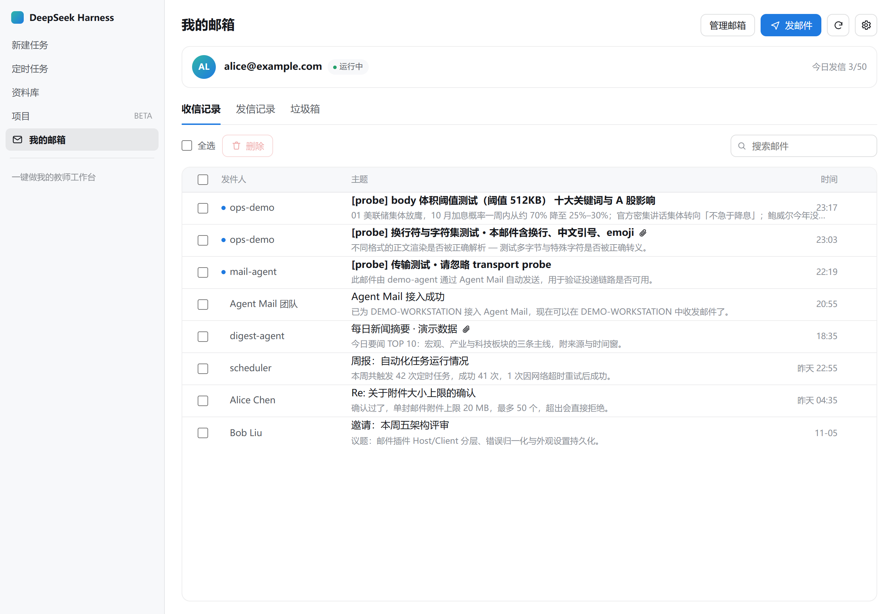

# dsh-tc-mail · 智能体邮箱

把 **腾讯 Agent Mail（智能体邮箱）** 做成 DeepSeek Harness 的原生面板：左侧栏入口、收/发件箱、读信、写信、搜索、软删除与永久删除，外加一个可调配字体、配色与透明度的设置弹框。

An Agent Mail client for [DeepSeek Harness](https://github.com/deepseek-ai/deepseek-harness): sidebar entry, native panel, full mail operations, and appearance settings for font, colour and transparency.



> 截图来自 `dev/preview.html` 本地预览挂具，数据全部为合成样例（`example.com`），不含任何真实邮箱内容。

---

## 特性

- **左侧栏入口**：`我的邮箱` 图标挂在 Harness 官方 `sidebar.panellist` 槽位，点击进入 `main` 主面板，与宿主其它面板行为一致。
- **收信 / 发信 / 垃圾箱**：三个视图，未读圆点、附件回形针、相对时间（今天 / 昨天 / 年月日）。
- **读信**：HTML 正文按原始排版渲染（保留邮件自带的 `<style>`），纯文本保留换行；附件逐个下载到 `~/.dsh/tc-mail/downloads/`。
- **写信 / 回复 / 转发**：支持抄送、密送、附件（单文件 ≤ 20 MB，账号上限 50 个）、全部回复、转发保留原件附件。
- **搜索**：关键词搜索，作用域跟随当前文件夹，输入即搜（320 ms 去抖）。
- **删除**：勾选后一次确认即**永久删除**（释放存储、不可恢复）。这个邮箱没有回收站——网页端同样没有，所以界面只保留「收信记录 / 发信记录」两个视图，不做一个用户找不到的垃圾箱。
- **设置**：字体族、字号、字体颜色、界面背景色、界面透明度、圆角、默认文件夹、自动刷新间隔、默认是否加载邮件图片，以及 `agently-cli` 路径与工作空间。改动即时预览，保存后写入 `~/.dsh/tc-mail/settings.json`。
- **Agent 工具**：`mail_list` / `mail_read` / `mail_search` / `mail_send` / `mail_trash`，与界面共用同一套 Host 服务层，模型和面板不会出现两套语义。
- **零运行时依赖**：插件本体不依赖任何 npm 包，不联网任何第三方服务。

## 安装（新用户三步）

> 顺序很重要：**先装插件，再在面板里装 CLI**。插件自带引导，不需要先开终端。

### 第 1 步：安装插件并重启

```bash
# 从 npm（发布后）
dsh plugin --profile <profile> add dsh-tc-mail

# 直接从 GitHub
dsh plugin --profile <profile> add github:<you>/dsh-tc-mail

# 本地开发目录（软链，改代码后重新构建并重启）
dsh plugin --profile <profile> add link:/absolute/path/to/dsh-tc-mail
```

或在 Harness 的「插件」页从本地目录安装。安装后**重启 Harness**，左侧栏出现 `我的邮箱`。

### 第 2 步：在面板里装 CLI 并授权

首次打开面板，如果本机没有 `agently-cli`，中间会显示引导：

1. 点 **「一键安装 agently-cli」** —— 用你机器上 npm 的全局目录安装，实时回显日志，不需要终端；
2. 装好后点 **「去授权」** —— 面板会拉起设备码授权，并把形如
   `https://agent.qq.com/page/oauth?oauth_type=device&user_code=uc_…` 的链接显示在面板里；
3. 在浏览器打开该链接、登录腾讯账号并确认，面板会在 2 秒内自动检测到授权完成，直接进入邮箱。

这一步是实测过的：非交互环境（无 TTY）下 CLI 会直接打印授权链接，不会自动弹浏览器，也不需要预装任何东西。

### 第 3 步：开始收发

授权完成后即可看到收件箱。**之前没有 Agent Mail 也能用**：授权过程会自动为你创建一个 `xxx@agent.qq.com` 地址，与个人邮箱完全隔离，无需先去官网注册。

如果自动安装失败（例如机器上没有可用的 npm），面板会同时给出可复制的命令，任选其一：

```bash
npm install -g @tencent-qqmail/agently-cli
agently-cli auth login
```

也可以让 Agent 代劳：把 <https://agent.qq.com/doc/cli-setup.md> 发给它。

## 使用

| 操作 | 位置 |
|---|---|
| 切换收信 / 发信 / 垃圾箱 | 面板内页签 |
| 读信 | 点击任意一行，正文区右上角可「显示图片」 |
| 回复 / 转发 | 读信视图右上角；列表行右侧也有快捷回复 |
| 写信 | 面板右上角「发邮件」 |
| 删除 | 勾选后点「删除」，确认后永久删除（无回收站） |
| 搜索 | 工具栏右侧输入框 |
| 设置 | 面板右上角齿轮 |
| 管理邮箱 | 打开 <https://agent.qq.com> |

### 设置项

| 分组 | 可调项 | 默认 |
|---|---|---|
| 字体 | 字体族（含预设与自定义）、字号 11–22px、字体颜色 | 跟随界面 |
| 界面 | 背景色、透明度 0–100%、圆角 0–24px | 跟随界面 / 100% / 12px |
| 行为 | 默认打开视图、自动刷新（关/30s/60s/5min）、默认加载邮件图片 | 收信记录 / 60s / 关 |
| 高级 | `agently-cli` 路径、`AGENTLY_WORKSPACE` | 自动探测 / 空 |

透明度低于 100% 时面板会启用 `backdrop-filter` 模糊，透过面板可以看到宿主壁纸。

> 自定义深色背景且未单独设置字体颜色时，插件会按背景亮度自动选择深色或浅色文字，避免不可读。

## 安全与隐私

这是本插件最需要说明的部分：

1. **不直连邮件 API**。所有操作通过本机 `agently-cli` 子进程完成；OAuth token 由 CLI 存入系统安全存储（Windows 为 DPAPI），插件从不读取、不落盘。
2. **参数不经 shell**。`spawn` 固定 `shell: false` + argv 数组；正文写到临时文件后用 `--body-file` 传入，同时满足 CLI「路径必须在 cwd 内」的限制，也避免超长或含特殊字符的参数。
3. **HTTP 接口仅限本机**。所有路由在 `/api/dsh-tc-mail` 前缀下，校验 loopback 来源、HTTP 方法与请求体大小上限。
4. **HTML 正文双层隔离**。邮件正文是不可信第三方内容，而渲染进程暴露了宿主能力，所以正文要过两道关：
   - 白名单消毒：移除 `script/iframe/object/embed/form/svg` 等标签、全部 `on*` 事件属性，`href`/`src` 只允许 `http(s)`/`mailto`/`tel`/`data:image`；
   - 渲染在 `sandbox="allow-popups"`（**无** `allow-scripts`、**无** `allow-same-origin`）的 iframe 内，并注入 `default-src 'none'` 的 CSP。
5. **外部图片默认拦截**，避免追踪像素；需要时点「显示图片」显式放行。
6. **无遥测**。插件不采集、不上报任何数据。

> 关于 `<style>`：为了保留营销邮件/通知邮件的排版，正文 `<style>` 会被保留。在没有脚本、没有同源权限、没有外部请求的沙箱里，CSS 不构成逃逸面。

## Agent 工具

| 工具 | 作用 |
|---|---|
| `mail_list` | 按文件夹列出邮件摘要 |
| `mail_read` | 读取正文与附件列表 |
| `mail_search` | 关键词搜索 |
| `mail_send` | 发送新邮件（纯文本） |
| `mail_health` | 查询当前授权的发件地址与今日发信额度 |

**删除不开放给 Agent**：这个邮箱没有回收站，删除即永久，因此只允许用户在面板里手动执行。

## 在对话里发邮件（Agent 集成）

启用本插件后，**不需要再装任何 skill**：它已经向 Harness 注册了 5 个工具（`mail_health / mail_list / mail_read / mail_search / mail_send`），并附带一段系统提示，声明「这是用户在 Harness 里唯一的收发邮件通道」。

所以直接在对话框里说：

> 用我的智能体邮箱给 alice@example.com 发一封邮件，主题「周报」，正文……

模型会调用 `mail_send`，发件人就是本机已授权的那个 `xxx@agent.qq.com`。不确定当前是哪个地址时，它会先调 `mail_health`。

需要澄清两点：

1. **不是「接管 dsh 的全部邮件能力」**——Harness 本身没有内置邮件功能，插件是**新增**了一套工具，而不是替换什么。如果你同时装了别的邮件插件，最终选哪个由模型按工具描述与系统提示判断；本插件的提示已明确声明自己是唯一通道，正常情况下会优先。
2. **skill 不是必需的**。工具自带参数 schema 与说明，模型可直接调用。skill 的合理用途是叠加写作规范、邮件模板、审批流程这类额外约束，与能不能发信无关。

验证方式：在 dsh 里说「列出我最近 3 封邮件」，或「用我的智能体邮箱给自己发一封测试邮件」。前者只会读，适合先确认工具链通了。

## 开发

```bash
npm install            # 只装 devDependencies（esbuild / react / playwright-core）
npm run build          # 生成 lib/index.js（Host，ESM）与 lib/client.js（浏览器端包装）
npm run watch          # 监听 src/
npm test               # node:test，21 个用例，不联网、不碰真实邮件
npm run preview        # 打开 dev/preview.html（本地预览挂具，合成数据）
npm run contract       # 抓取 agently-cli 的 --print-output-schema 快照到 test/contract/
```

目录：

```
src/host/      cli.js（子进程封装）· mail-service.js（唯一实现）· routes.js · settings-store.js · tools.js
src/client/    index.jsx（槽位注册）· panel.jsx（状态机）· theme.js · sanitize.js · components/
lib/           构建产物，随包发布
dev/           预览挂具与本地截图（不发布，real-app 截图含真实数据，勿提交）
test/          单元测试 + CLI 契约快照
```

调试提示：

- 客户端产物必须是 `window.__ModuleLoader__.load({ id, factory })` 包装的惰性 CJS，`react` 与 `react/jsx-runtime` 由宿主模块表提供，构建时保持 external。
- 宿主主题变量声明在 `body` 而不是 `:root`，且皮肤会把 `--dsw-alias-bg-layer-*` 改成半透明 `color-mix()`。因此插件在 JS 里解析主题、合成实际渲染色，再把具体值以 `--tc-*` 传给面板与弹框（弹框被 portal 到 `body`，拿不到 `.tc-root` 的作用域）。
- 侧边栏条目与 `main` 槽必须成对注册，`ctx.layout.selectPanel(id)` 找不到 `main` 条目会抛错。

## 兼容性

- Harness `0.2.2-rc.1` 实测通过（Windows / Edge 内核）。
- 需要宿主提供 `webServer`；`tools` 与 `systemPrompt` 为可选服务，缺失时插件仍可只用界面。
- `agently-cli` 版本以 `1.0.18` 为基线；升级后可用 `npm run contract` diff 字段漂移。

## FAQ

**Q：面板显示「还没安装 agently-cli」，但我明明装过？**
这是 Windows 上最常见的一类问题：`npm i -g` 把包装进了某个全局前缀，而 GUI 启动的应用继承不到该目录的 PATH（便携版 Node、nvm-windows、Volta、fnm，或某些软件自带运行时都会这样）。插件为此做了两级兜底：

1. 除了 PATH，还会扫描常见全局前缀（`%APPDATA%\npm`、`%LOCALAPPDATA%\npm`、`Program Files\nodejs`、nvm/fnm/Volta 的版本目录等），并在其中直接定位**平台二进制**；
2. 仍然找不到时，可在设置 → 高级里填 `agently-cli` 的绝对路径（指向 `agently-cli.exe` 最稳）。

**Q：面板显示「agently-cli 无法运行」？**
说明找到了包但执行失败，通常是全局安装残缺（只有 `scripts/run.js`、缺 `@tencent-qqmail/agently-cli-<平台>` 这个平台包）。点「重新安装」即可修复。

**Q：为什么以前会闪一个黑色命令行窗口？**
那是 `agently-cli.exe` 作为控制台程序被间接拉起时的窗口。旧实现走 npm shim：`node scripts/run.js` 再由它拉起 `.exe`，而中间那层 `run.js` 拉起子进程时没有隐藏控制台，于是闪一下。现在解析器优先直接命中原生 `.exe`（并且每次 `spawn` 都带 `windowsHide`），这条链路已经不存在了。

**Q：读信后邮件仍是未读？**
列表的已读状态以服务端返回为准，插件不伪造状态。若服务端未标记已读，界面也会如实显示。

**Q：为什么发件箱的收件人有时为空？**
列表接口不保证返回 `to`。插件不做猜测，读到详情后才补全。

**Q：删掉的邮件能恢复吗？**
**不能，删除即永久。** 这个邮箱（含网页端）没有回收站，`agently-cli` 也只提供「移入垃圾箱」与「永久删除」两个底层动作、没有还原命令。所以插件把「删除」直接实现为永久删除：一次确认，之后不可找回。早期版本留下的垃圾箱视图已移除。

**Q：多个邮箱账号？**
`agently-cli` 以 `AGENTLY_WORKSPACE` 区分登录态，在设置 → 高级里切换即可。

## License

MIT
